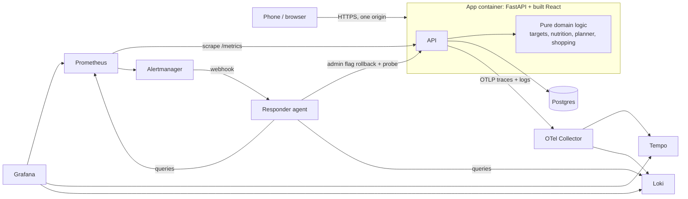

# Pantry Plan

A mobile-first meal planner for families who want to lose weight together. Everyone eats the same dinner, but each person gets a portion sized to their own calorie target, and one combined shopping list covers the whole week.

> Final project for the AI Dev Tools course. Specified, built, tested, containerised, deployed, instrumented and made self-healing with a team of AI agents. See [Agent team](#agent-team).

## The problem

Turning "I want to lose 0.5 kg a week" into seven days of meals the whole family will actually cook is tedious:

- Diet plans are built for one person, so the family ends up cooking several different dinners.
- Recipes rarely show prep time or macros, so you cannot tell what fits your day or your target.
- The shopping list gets assembled by hand, and quantities never match who is actually eating.

## What it does

| Feature | Behaviour |
|---|---|
| **Household login** | One household account (e-mail + password). Family members are profiles inside it. A household can never see another's data. |
| **Calorie and macro targets** | Per person, from age, sex, height, weight, activity and a goal of 0.1-1.0 kg/week (Mifflin-St Jeor). Safety floors of 1500 / 1200 kcal; children use a custom calorie target. Protein, fat and carbs are shown for every person. |
| **Recipes with time and macros** | 31 bundled recipes (easy / medium / hard). Macros per serving are **computed from the ingredients** using a built-in nutrition table (about 70 ingredients, USDA-derived). Add your own recipes; unknown ingredients ask for their nutrition per 100 g. |
| **Plan the week by ease** | Choose the hardest recipe you will cook and your cooking time per day. The planner fills Monday-Sunday and sizes every person's portion (0.5 to 2 servings, quarter steps) so **each person lands within ±10% of their own daily target**. Swap any meal, change a portion, or let someone skip a meal. |
| **Shopping list** | Sums everyone's portions across the week, merges units, rounds countable items up, groups by supermarket aisle, and saves ticks on the server (and the last list on the phone for poor signal in the shop). |
| **Phone first** | Bottom tab bar, large tap targets, single-column forms, no horizontal scrolling at 375 px. |

Calorie and macro figures are estimates, not medical advice; the app says so wherever targets appear.

The full behaviour, with numbered acceptance criteria, is in [docs/SPEC.md](docs/SPEC.md).

## Run it

You need Docker Desktop. One command starts everything, including the database:

```bash
py scripts/dev.py up          # Windows
python3 scripts/dev.py up     # macOS / Linux
```

On first run it generates a git-ignored `.env` with random secrets. Then open:

| What | URL |
|---|---|
| The app | http://localhost:8080 |
| Grafana (dashboard "User journeys") | http://localhost:3001 |
| Prometheus | http://localhost:9091 |
| Responder agent incidents | http://localhost:9000/incidents |

Stop with `py scripts/dev.py down` (add `--volumes` to also delete the database).

## Test it

```bash
py scripts/dev.py test
```

Runs every suite and prints a summary: backend unit and integration tests (against a throwaway **Postgres** container), frontend tests, responder tests, and Prometheus alert-rule tests.

| Suite | Where | What it covers |
|---|---|---|
| Unit | `backend/tests/unit` | targets, nutrition, portions, planner, shopping list, log redaction |
| Integration | `backend/tests/integration` | HTTP API on a real database: auth, household isolation, recipes, planning, shopping list, metrics, feature flag, migrations |
| Frontend | `frontend/tests` | API client, every page, offline shopping list |
| Responder | `responder/tests` | tools, guardrails, rollback, prompt-injection, de-duplication |
| Alert rules | `observability/alerts_test.yml` | when the alert fires and when it must not |

## Architecture



More detail: [docs/ARCHITECTURE.md](docs/ARCHITECTURE.md).

## Observability and alerting

The key user journey, **generating the shopping list**, is instrumented end to end:

- **Metrics** (`journey_requests_total`, `journey_duration_seconds`) with the trace id attached to latency samples as exemplars.
- **Traces** for every request (OpenTelemetry to Tempo).
- **Structured JSON logs** carrying the same `trace_id` (to Loki).
- The response header `X-Trace-Id` is shown in the app footer, so a user's problem can be tied to one trace.
- No e-mails, passwords, cookies, weights or ages reach telemetry; a redaction filter and tests enforce it.

One alert, **ShoppingListFailureRate**, measures what users feel: more than 5% of real shopping-list requests failing with a server error. It ignores synthetic probe traffic and client errors. Details: [docs/OBSERVABILITY.md](docs/OBSERVABILITY.md).

## On-call agent

When the alert fires, Alertmanager wakes the **responder** (`responder/`). It investigates (metrics, logs, feature flags), rolls back the risky flag that caused the incident, proves recovery with a synthetic shopping-list probe, and writes an incident report. If it cannot find a safe fix it escalates (report plus a GitHub issue) instead of guessing.

- With `ANTHROPIC_API_KEY` set it runs a Claude tool-use loop; without one it follows a deterministic playbook, so the demo works offline.
- Guardrails are enforced in code: allow-listed tools, flags can only be turned **off**, "resolved" is refused until a probe passes, log text is treated as untrusted data.
- The fix is a **rollback plus report**. It does not write code.

Try it: `py scripts/dev.py simulate-incident` switches on the broken `shopping_list_v2` flag, drives user traffic, and shows the alert, the responder and the recovery. Runbook: [docs/RUNBOOK.md](docs/RUNBOOK.md).

## Agent team

The project was built by role-specialised agents working from a public task tracker.

| Role | Responsibility |
|---|---|
| Product/Spec | spec and acceptance criteria, backlog |
| Backend | API, domain logic, database, migrations |
| Frontend | mobile UI |
| QA | edge cases, isolation, review |
| DevOps/SRE | containers, CI/CD, observability, alerts |
| On-call Responder | the agent that runs in production-like conditions |

Roles, hand-offs and the process: [docs/AGENT_TEAM.md](docs/AGENT_TEAM.md), [docs/PROCESS.md](docs/PROCESS.md). Context for agents working in this repo: [AGENTS.md](AGENTS.md). Tasks and acceptance criteria: [GitHub Issues](https://github.com/thestronghearted/Pantry/issues), mirrored in [docs/tasks/BACKLOG.md](docs/tasks/BACKLOG.md).

## CI/CD and deployment

- **Every pull request** runs backend (Postgres), frontend, responder and alert-rule tests, builds the images and checks that the whole system starts. See [.github/workflows/ci.yml](.github/workflows/ci.yml).
- **Merge to `main`** builds one image tagged `sha-<commit>`, deploys it to **dev** automatically, then waits for a reviewer to approve **prod**, which receives the *same* image. See [cd.yml](.github/workflows/cd.yml).
- **Rollback**: run the *Rollback* workflow with an earlier `sha-…` tag. See [docs/DEPLOY.md](docs/DEPLOY.md).
- **Hosting**: Render (app) and Neon (Postgres). Live URLs: see the repository's Environments tab and [docs/DEPLOY.md](docs/DEPLOY.md#live-environments).

## Limits and honest notes

- Nutrition values are rounded estimates, not clinical data.
- One household login; family members do not have their own logins. No password reset by e-mail.
- Deployed environments run the app and database; the Grafana/Prometheus/responder stack runs locally (Docker Compose) and is demonstrated with the incident drill.
- The nutrition-based planner only fits **calories** within ±10% per person; macros are reported, not optimised.

## Repository map

```
backend/        FastAPI app, pure domain logic (app/domain), Alembic migrations, tests
frontend/       React (Vite) app and tests
responder/      on-call agent, tools, guardrails, tests
observability/  collector, Tempo, Loki, Prometheus rules (+ tests), Alertmanager, Grafana
scripts/        dev.py (up/down/test/simulate-incident), incident drill, backlog publisher
docs/           spec, process, agent team, architecture, observability, runbook, deploy
.github/        CI, CD and rollback workflows
```
